<div align="center">


# Software Karkhana

### Autonomous where it's safe. *Accountable where it matters.*

A governed AI software factory. AI agents do the work one task at a time; product, design, architecture, engineering, QA and security share one workspace; and a named person signs every decision on a ledger anyone can verify.

<br/>

[](#-built-on-google-cloud)
[](#-built-on-google-cloud)
[](#-falkordb-the-engineering-intelligence-graph)
[](#-the-evidence-ledger)
[](https://www.npmjs.com/package/karkhana-agent)
<br/>
[](app/)
[](web/)
[](db/)
[](LICENSE)

**[🌐 Live site](https://software-karkhana.web.app)** &nbsp;·&nbsp;
**[🎬 Demo video](#-see-it-in-three-minutes)** &nbsp;·&nbsp;
**[🏛️ Architecture](#-system-architecture)** &nbsp;·&nbsp;
**[🕸️ FalkorDB](#-falkordb-the-engineering-intelligence-graph)** &nbsp;·&nbsp;
**[⚡ Quick start](#-quick-start)** &nbsp;·&nbsp;
**[📚 Docs](#-documentation)**

</div>

---

## 🎬 See it in three minutes

<div align="center">

<a href="web/public/video/karkhana-explainer.mp4">
  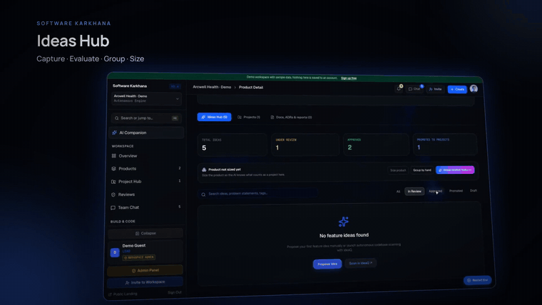
</a>

<sub>▶️ Click for the full three-minute explainer with narration (<a href="web/public/video/karkhana-explainer.mp4">MP4</a>), or watch it autoplay on the <a href="https://software-karkhana.web.app">landing page</a>.</sub>

</div>

---

## ✨ Why Software Karkhana

AI can already write code. What it cannot do yet is **earn trust**. Teams copy context between Jira, Figma, Confluence and GitHub, an agent says "done" with nothing to back it up, approvals get lost in chat threads, and last quarter's incident is forgotten by the next sprint.

*Karkhana* is the Hindi and Urdu word for a workshop where many hands make one thing. Software Karkhana is that workshop for software:

<table>
<tr>
<td width="33%" valign="top">

### 🤖 Autonomous at task level
Agents plan, code, test, review and scan **one task at a time** inside a confined sandbox, with five tools and real test runs. Nothing runs unattended at project scale.

</td>
<td width="33%" valign="top">

### 🧑‍⚖️ Accountable at gate level
**15 stages, 8 roles, server-enforced gates.** No agent approves its own change. A named person signs each gate, and the server refuses anything out of order.

</td>
<td width="33%" valign="top">

### 🔗 Proof, not promises
"Done" means a **real test exit code and a diff**. Every transition, approval and run lands on a **SHA-256 hash-chained ledger** you can verify in one click.

</td>
</tr>
<tr>
<td valign="top">

### 🕸️ Shared context graph
A **FalkorDB** knowledge graph links products, epics, tasks, files, ADRs and lessons, so each agent gets only what it needs and two agents never overwrite one file.

</td>
<td valign="top">

### ☁️ Google Cloud native
**Gemini 3 on Vertex AI, Google ADK, Cloud Run + Jobs, Cloud SQL, Firebase, Stitch, AX, OSV-Scanner**: one service per job, scaled to zero when idle.

</td>
<td valign="top">

### 💻 Build on your own machine
The **`karkhana-agent`** npm package connects a developer laptop. Your coding agent (Bob or Claude Code) builds the story locally; the platform reviews it and opens the PR.

</td>
</tr>
</table>

| | The disconnected enterprise | With Software Karkhana |
|:--|:--|:--|
| **Context** | PM in Jira, design in Figma, architects in Confluence, devs in the IDE. Context dies at every handoff. | One project graph. Acceptance criteria, ADRs and rules travel with every story and agent task. |
| **AI output** | An agent says "done" and nobody can tell what it checked. | Completion needs a test run, a diff and evidence. Then a named person signs. |
| **Approvals** | Architecture, security waivers and releases are approved in email and chat. | Role-enforced gates. Director, Architect, AppSec and QA each hold explicit authority. |
| **Learning** | Post-mortems fade into wikis; mistakes repeat. | Verified lessons are retrieved (pgvector + graph) and injected into the next agent run. |
| **Audit** | Finding who approved a change takes days of log digging. | Every action is a block in a SHA-256 chain, anchored in Cloud Storage. |

---

## 📸 Inside the product

<table>
<tr>
<td width="50%">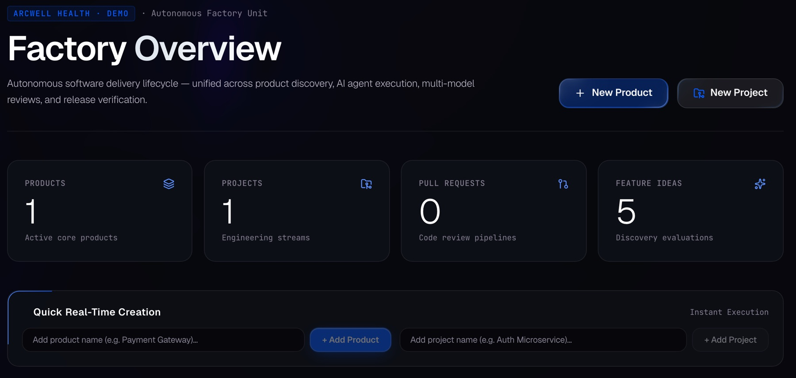<br/><sub><b>Factory overview</b>: one home for every product, project, PR and idea, with live counts.</sub></td>
<td width="50%">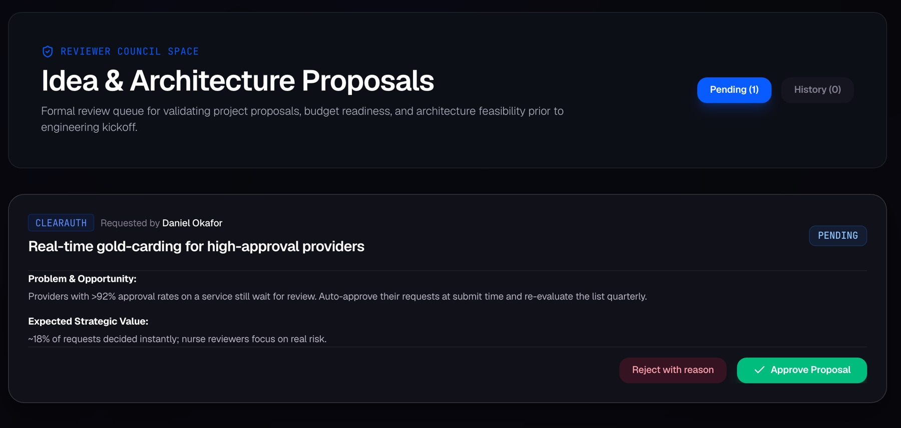<br/><sub><b>Director review</b>: problem, value and risk on one card; approve or reject with a reason.</sub></td>
</tr>
<tr>
<td>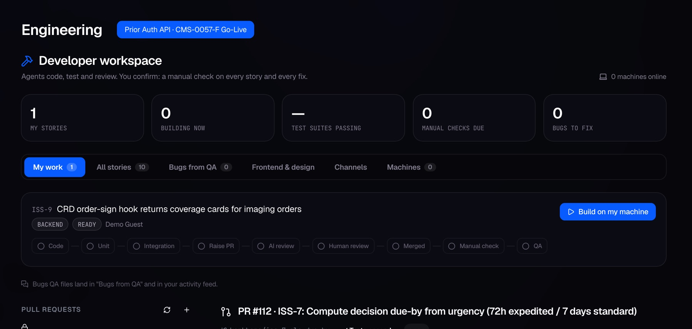<br/><sub><b>Developer workspace</b>: assign a story to an agent or your machine; AI findings must be triaged before merge.</sub></td>
<td>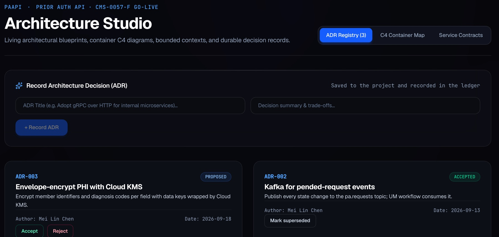<br/><sub><b>Architecture Studio</b>: ADR registry and service contracts every task is built against.</sub></td>
</tr>
<tr>
<td>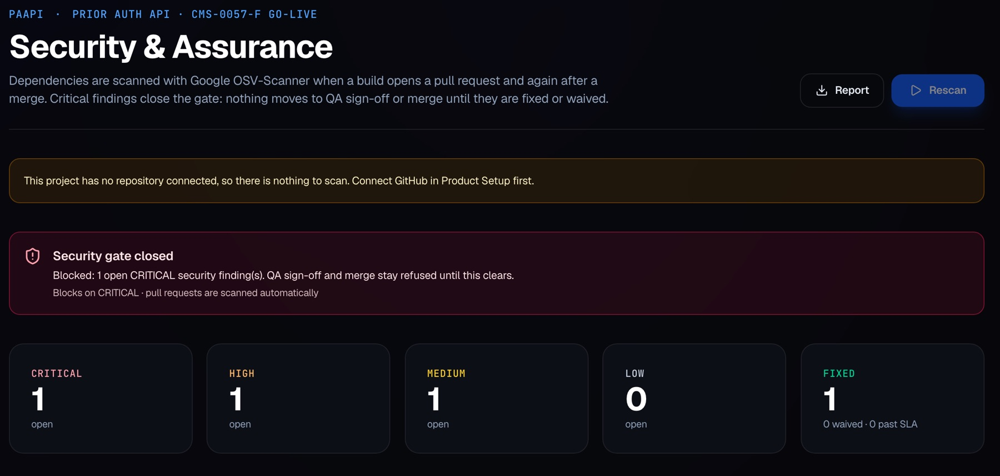<br/><sub><b>Security gate</b>: OSV-Scanner on every PR; a CRITICAL finding closes the gate until fixed or waived.</sub></td>
<td>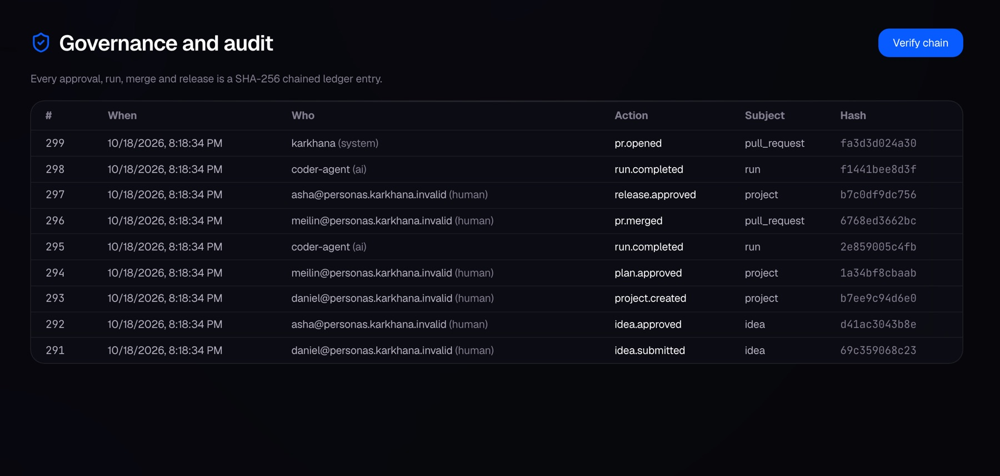<br/><sub><b>Governance and audit</b>: every approval, run and merge is a chained row; verify recomputes every hash.</sub></td>
</tr>
</table>

---

## 🔄 How work moves

Many products and projects share **one workspace, one context and one ledger**, moving through **15 gated stages in five phases** (Plan → Build → Verify → Ship → Learn). Each stage has an owner role and an exit gate; design runs in parallel with architecture, and QA in parallel with security.

<p align="center">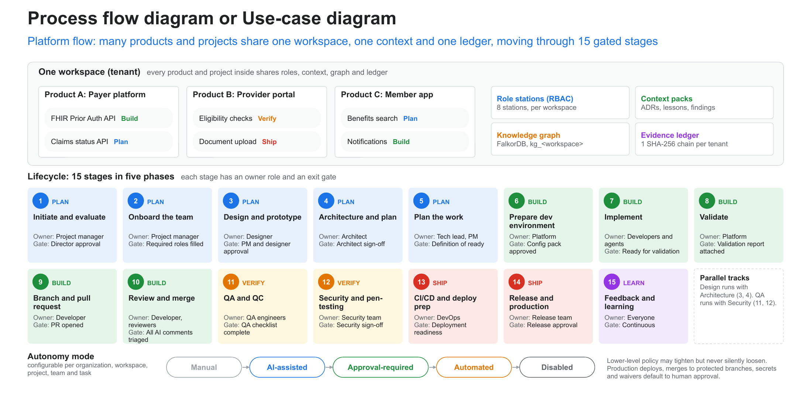</p>

**An end-to-end example**: a health plan ships a FHIR Prior Authorization API, from idea to release, with six human gates and every step on the ledger.

<p align="center">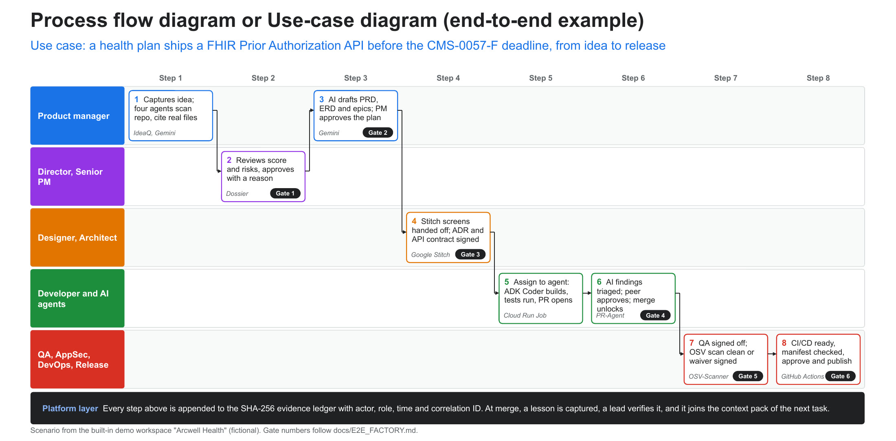</p>

<details>
<summary><b>The 15 stages and who owns them</b></summary>

| # | Phase | Stage | Owner | Exit gate |
|:-:|:--|:--|:--|:--|
| 1 | Plan | Initiate and evaluate | Product manager | Director approval |
| 2 | Plan | Onboard the team | Product manager | Required roles filled |
| 3 | Plan | Design and prototype | Designer | PM and designer approval |
| 4 | Plan | Architecture and plan | Architect | Architect sign-off |
| 5 | Plan | Plan the work | Tech lead, PM | Definition of ready |
| 6 | Build | Prepare dev environment | Platform | Config pack approved |
| 7 | Build | Implement | Developers and agents | Ready for validation |
| 8 | Build | Validate | Platform | Validation report attached |
| 9 | Build | Branch and pull request | Developer | PR opened |
| 10 | Build | Review and merge | Developer, reviewers | All AI comments triaged |
| 11 | Verify | QA and QC | QA engineers | QA checklist complete |
| 12 | Verify | Security and pen-testing | Security team | Security sign-off |
| 13 | Ship | CI/CD and deploy prep | DevOps | Deployment readiness |
| 14 | Ship | Release and production | Release team | Release approval |
| 15 | Learn | Feedback and learning | Everyone | Continuous |

Autonomy is configurable per organization, workspace, project, team and task (*Manual → AI-assisted → Approval-required → Automated → Disabled*). A lower level may tighten policy but never silently loosen it.

</details>

---

## 🏛️ System architecture

A **modular-monolith control plane on Cloud Run**, a **sandboxed execution plane**, **Gemini on Vertex AI**, and evidence in **Cloud SQL**. Layers import downward only, and the boundaries are enforced in CI with import-linter.

<p align="center">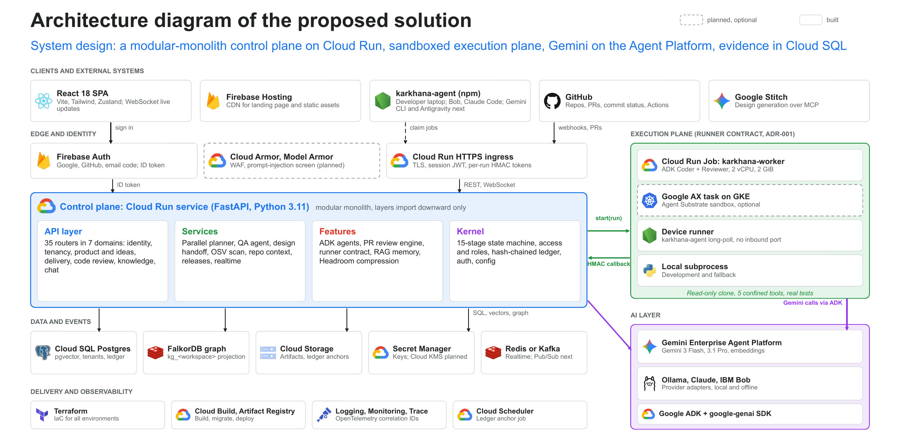</p>

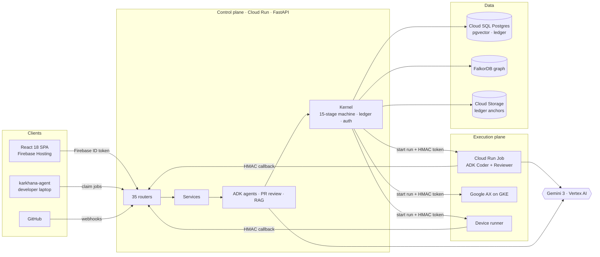

<details>
<summary><b>What each layer does</b></summary>

| Layer | Responsibility |
|:--|:--|
| **API** | 35 routers in 7 domains: identity, tenancy, product and ideas, delivery, code review, knowledge, chat. |
| **Services** | Parallel planner, QA agent, design handoff, OSV scan, repo context, releases, realtime. |
| **Features** | ADK agents, PR review engine, runner contract, RAG memory, Headroom context compression. |
| **Kernel** | 15-stage state machine, access and roles, hash-chained ledger, auth, config. |
| **Execution plane** | Runner contract (ADR-001): Cloud Run Job, Google AX task, device runner or local subprocess. Read-only clone, five confined tools, real tests, HMAC-signed callback. |
| **AI layer** | Gemini 3 Flash for the coding loop, Gemini 3.1 Pro for planning and review, Gemini embeddings; Ollama, Claude and IBM Bob as provider adapters. |

</details>

---

## 🕸️ FalkorDB: the engineering intelligence graph

Agents are only as good as the context they work with. Software Karkhana keeps a **FalkorDB property graph** per workspace (`kg_<workspace>`) that connects **Product → Project → Epic → Task → Run/PR**, and links tasks to the **Components** they touch, the **ADRs** that govern them and the **Learnings** about them.

<p align="center">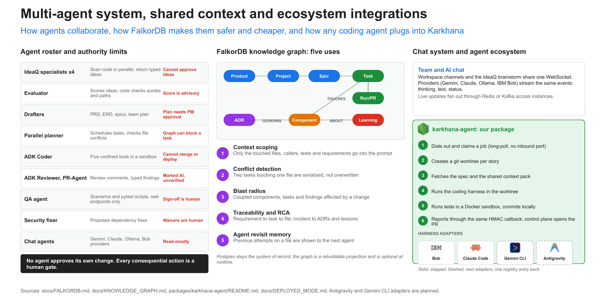</p>

| | Use | What the graph does | Measured |
|:-:|:--|:--|:--|
| 1 | **Context scoping** | Only the touched files, their callers, tests and requirements go into the prompt. | **~274 chars vs 1.78M**, 100% recall |
| 2 | **Conflict detection** | Two tasks touching one file are serialised, never overwritten. | **Precision 1.0 · Recall 1.0** on 500 task pairs |
| 3 | **Blast radius** | Shows the components, tasks and findings a change affects. | p50 **35 ms** |
| 4 | **Traceability and RCA** | Requirement → task → file; incident → ADRs and lessons. | |
| 5 | **Agent revisit memory** | Previous attempts on a file are shown to the next agent, so it does not repeat a failed approach. | |

Postgres stays the system of record: the graph is a **rebuildable projection** fed from the ledger, and the platform falls back to a no-op backend if FalkorDB is not running. Code: [`app/graph/`](app/graph/) · Guide: [`docs/FALKORDB.md`](docs/FALKORDB.md) · Schema: [`docs/KNOWLEDGE_GRAPH.md`](docs/KNOWLEDGE_GRAPH.md)

---

## ☁️ Built on Google Cloud

| Google product | How Software Karkhana uses it |
|:--|:--|
| **Gemini 3 Flash · 3.1 Pro (Vertex AI)** | Flash runs the coding loop, IdeaQ and chat; Pro plans and reviews. With no API key set, every call goes through **Vertex AI** with the service account. |
| **Google ADK + google-genai** | The ADK Coder and Reviewer: five workspace-confined tools (list, read, edit, write, test) and typed outputs. |
| **Cloud Run (service)** | The control plane. Scales to zero, session JWTs, per-run HMAC tokens. |
| **Cloud Run Jobs** | Every agent run is its own Job (2 vCPU, 2 GiB), so one run can never touch another. |
| **Google AX on GKE** | Optional Agent Substrate sandbox for heavier agent tasks, behind the same runner contract. |
| **Cloud SQL for PostgreSQL + pgvector** | Tenants, the advisory-locked ledger, and vector search over verified lessons. |
| **Firebase Auth + Hosting** | Sign in with Google, GitHub or an email code; CDN for the app, landing page and docs. |
| **Cloud Storage** | Run artifacts and **ledger anchors** in a retention-policy bucket outside the database. |
| **Secret Manager** | Model keys and tokens at rest (Cloud KMS planned). |
| **Google Stitch (MCP)** | Design screens generated over MCP, held at a handoff gate until PM and designer approve. |
| **OSV-Scanner** | Google's open-source vulnerability scanner runs on every PR; a CRITICAL finding closes the security gate. |
| **Cloud Build, Artifact Registry, Scheduler, Logging, Trace** | Build, migrate and deploy in one pipeline; a scheduled ledger-anchor job; OpenTelemetry correlation IDs from click to agent run. |

<p align="center">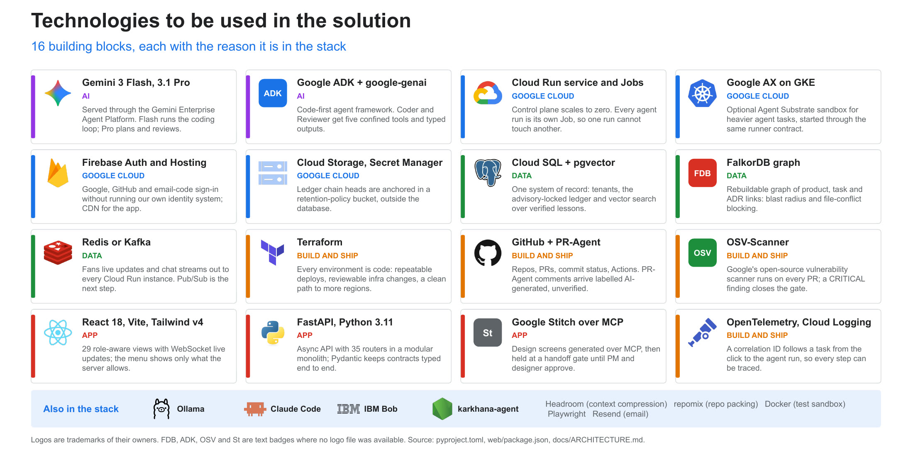</p>

---

## 🤖 The agents, and what they are not allowed to do

| Agent | Does | Cannot |
|:--|:--|:--|
| **IdeaQ specialists ×4** | Scan the repo in parallel (repomix pack, Headroom-compressed) and return typed ideas | Approve ideas; ideas citing files that do not exist are dropped |
| **Evaluator** | Scores Value, Usability, Feasibility, Viability; every quote must match the source verbatim | Its score is advisory |
| **Drafters** | PRD, ERD, epics, team plan | The plan needs PM approval |
| **Parallel planner** | Schedules tasks and checks file conflicts in the graph | The graph can block a task |
| **ADK Coder** | Five confined tools in a sandbox, real tests | Merge or deploy |
| **ADK Reviewer, PR-Agent** | Review comments and typed findings | Findings stay "AI, unverified" until a person triages them |
| **QA agent** | Scenarios and pytest scripts against real endpoints | Sign-off is human |
| **Security fixer** | Proposes dependency fixes | Waivers are human |

> **No agent approves its own change. Every consequential action is a human gate.**

---

## 🔒 The evidence ledger

Every significant action appends a block to an append-only, **SHA-256 hash-chained ledger** ([`app/ledger.py`](app/ledger.py)): sequence number, timestamp, actor (person or agent), event, payload, previous hash and its own hash. Changing any past entry breaks every hash after it, and the database role cannot `UPDATE` or `DELETE` ledger rows. Chain heads are anchored in Cloud Storage on a schedule. Details: [`docs/LEDGER.md`](docs/LEDGER.md).

---

## 📊 Benchmarks

**27,700+ attacks, forgeries and fabricated outputs** run against the real platform (real worker, pytest, Postgres, ledger, API and FalkorDB; only model calls are deterministic fakes, so every run repeats exactly). Every one was stopped.

<p align="center">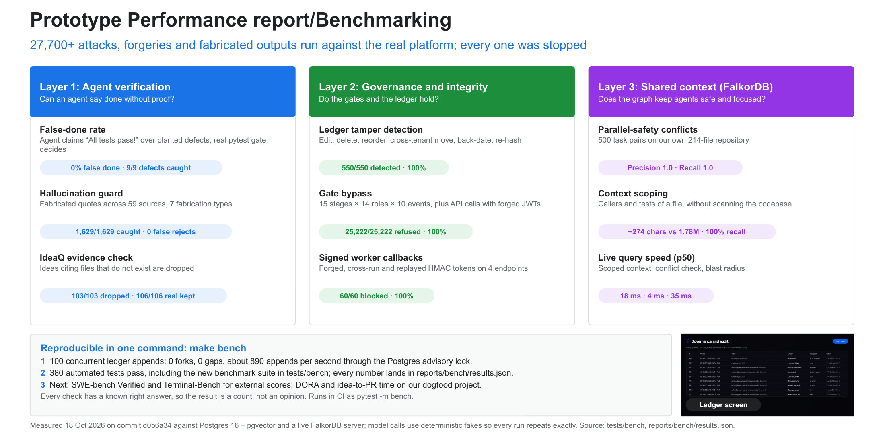</p>

| Layer | Benchmark | Result |
|:--|:--|:--|
| Agent verification | False-done rate (agent claims "all tests pass" over planted defects) | **0% false done**, 9/9 defects caught |
| | Hallucination guard (fabricated quotes, 59 sources, 7 types) | **1,629 / 1,629 caught**, 0 false rejects |
| | IdeaQ evidence check | **103 / 103** fake citations dropped, 106 / 106 real kept |
| Governance | Ledger tamper detection (edit, delete, reorder, back-date, re-hash) | **550 / 550 detected** |
| | Gate bypass (15 stages × 14 roles × 10 events + forged JWTs) | **25,222 / 25,222 refused** |
| | Signed worker callbacks (forged, cross-run, replayed HMAC) | **60 / 60 blocked** |
| Shared context (FalkorDB) | Parallel-safety conflicts, 500 task pairs | **Precision 1.0 · Recall 1.0** |
| | Context scoping | **~274 chars vs 1.78M**, 100% recall |
| | Query speed p50 (scope · conflict · blast radius) | **18 ms · 4 ms · 35 ms** |

Reproduce with one command: `make bench` (results in [`reports/bench/results.json`](reports/bench/results.json), code in [`tests/bench/`](tests/bench/)).

---

## 💻 `karkhana-agent`: build on your own machine

```bash
# In the app: Developer → My machines → Connect a machine, then copy the command it shows.
npm install -g karkhana-agent
karkhana-agent login --server https://<your-server> --code XXXX-XXXX --harness bob   # or claude
karkhana-agent work
```

The agent dials out (no inbound port), claims a job, creates a git worktree per story, runs your coding agent there, runs the tests in a Docker sandbox, commits locally and reports back through the same HMAC callback. The control plane reviews the change and opens the PR. Model keys and source code stay on your machine. [Package README](packages/karkhana-agent/README.md) · [npm](https://www.npmjs.com/package/karkhana-agent)

---

## 📈 What changes for each team

<p align="center">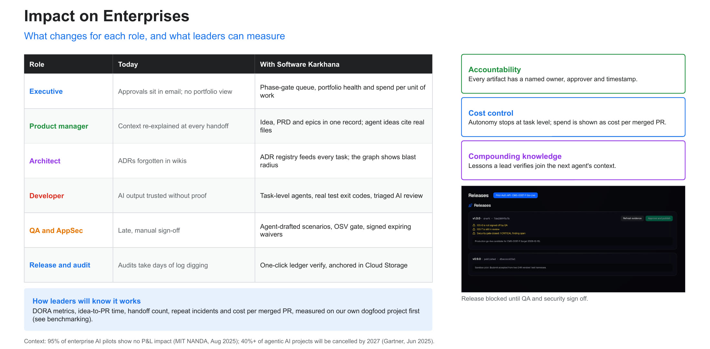</p>

---

## ⚡ Quick start

**Needs:** Python 3.11+ with [uv](https://docs.astral.sh/uv/), Node 20+, PostgreSQL 16 with `pgvector`. Optional: FalkorDB (`docker run -p 6379:6379 falkordb/falkordb`), Ollama for local models, Docker for sandboxed tests.

```bash
git clone https://github.com/dhruvinsights/Software-Karkhana.git && cd Software-Karkhana
make install        # uv sync + web dependencies
make db-local       # Postgres roles and database (pgvector)
make migrate        # schema + demo users
make dev            # API on http://localhost:8080 (OpenAPI at /docs)
make web            # app on http://localhost:5173, proxies /api to :8080
```

**Models.** Copy [`.env.example`](.env.example) to `.env`. To run everything on **Gemini through Vertex AI**, leave `GEMINI_API_KEY` unset and set:

```bash
GOOGLE_CLOUD_PROJECT=<your-project>   # billing and the aiplatform API enabled
LLM_PROVIDER=gemini
EMBED_PROVIDER=gemini
CHAT_DEFAULT_PROVIDER=gemini
```

then `gcloud auth application-default login` and `make check-models`. For fully local runs, use `LLM_PROVIDER=ollama` and `EMBED_PROVIDER=ollama`.

**Graph.** Set `FALKORDB_URL=redis://localhost:6379` to turn the knowledge graph on; without it the platform runs exactly the same, minus graph context.

**Tests.** `make test` (365+ tests), `make lint`, `make arch` (module boundaries), `make bench` (benchmarks). Windows: [`docs/LOCAL_WINDOWS.md`](docs/LOCAL_WINDOWS.md). Deploying to Google Cloud: `make deploy` and [`docs/GO_LIVE.md`](docs/GO_LIVE.md).

---

## 🗂️ Repository layout

```
app/                FastAPI control plane
  routers/          35 API routers (identity, tenancy, ideas, delivery, review, knowledge, chat)
  services/         planner, QA agent, design handoff, OSV scan, releases, realtime
  agents/           ADK Coder and Reviewer
  ai/               Gemini / Vertex AI, Ollama, Claude and Bob providers; chat; compression
  graph/            FalkorDB engineering intelligence graph (+ no-op fallback)
  runner/           runner contract: Cloud Run Job, Google AX, device, local
  worker/           sandboxed agent worker
  ledger.py         SHA-256 hash-chained evidence ledger
web/                React 18 + Vite + Tailwind v4 app, landing page and docs site
packages/karkhana-agent/   npm package that connects a developer machine
db/                 migrations
tests/              unit, integration, e2e and bench suites
docs/               architecture, FalkorDB, ledger, runbooks and guides
```

---

## 📚 Documentation

| | |
|:--|:--|
| 🏛️ [Architecture](docs/ARCHITECTURE.md) | 🕸️ [FalkorDB integration](docs/FALKORDB.md) · [Knowledge graph](docs/KNOWLEDGE_GRAPH.md) |
| 🔒 [Evidence ledger](docs/LEDGER.md) | 🏭 [Idea-to-release runbook](docs/E2E_FACTORY.md) |
| 🚢 [Go-live guide](docs/GO_LIVE.md) · [Deployed mode](docs/DEPLOYED_MODE.md) | 🛡️ [OSV-Scanner](docs/OSV_SCANNER.md) · 🤖 [PR bot](docs/PR_BOT.md) |
| 📜 [Build log and decisions](docs/BUILD_LOG.md) | 🎓 [Learning guide](docs/LEARNING_GUIDE.md) · 📚 [Wiki](docs/wiki/README.md) |
| 💻 [karkhana-agent](packages/karkhana-agent/README.md) | 🪟 [Windows setup](docs/LOCAL_WINDOWS.md) |

---

## 👥 The team

<table>
<tr>
<td align="center"><br/><b>Dhruv Chaturvedi</b></td>
<td align="center"><br/><b>Eshita Khakharia</b></td>
<td align="center"><br/><b>Yagnik Sharma</b></td>
<td align="center"><br/><b>Sameeksha Sahani</b></td>
</tr>
</table>

---

## 📄 License

Copyright © 2026 Software Karkhana authors. Licensed under the [Apache License, Version 2.0](LICENSE). Third-party notices are in [`THIRD_PARTY_NOTICES.md`](THIRD_PARTY_NOTICES.md). FalkorDB is used under its own license; see [`docs/FALKORDB.md`](docs/FALKORDB.md#license-note) for alternatives.

<div align="center"><sub>Autonomous where it's safe. Accountable where it matters.</sub></div>
