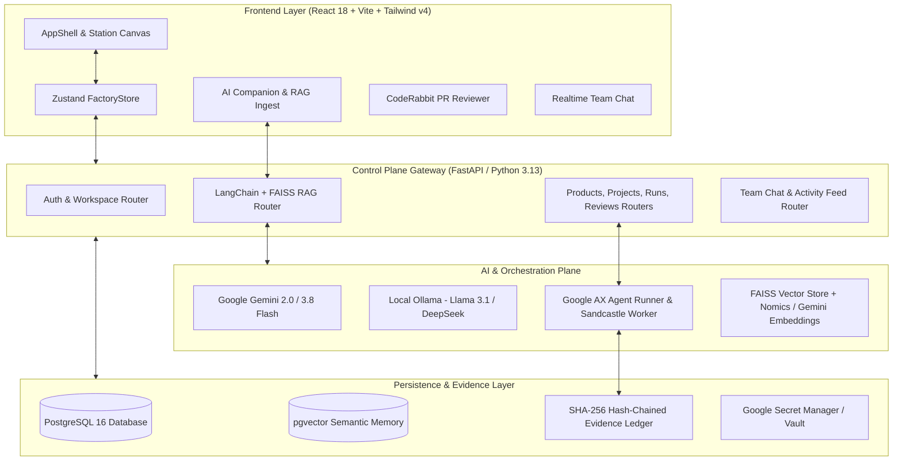

# 01. System Overview & Technology Stack

## 🏗️ Architecture Overview

Software Karkhana is an enterprise-grade autonomous software delivery platform and control plane that brings ideas to solutions through a verifiable, evidence-backed AI orchestration engine.

---

## 🛠️ Technology Stack Breakdown

### 1. Backend & Control Plane (`app/`)
- **FastAPI (Python 3.13 / Pydantic v2)**: High-performance async REST API providing OpenAPI schemas, JWT validation, and real-time streaming endpoints.
- **SQLAlchemy 2.0 (Async Engine) + asyncpg**: Pure async database interactions with connection pooling.
- **PostgreSQL 16 + pgvector**: Relational entities and vector embeddings for long-term project knowledge and post-mortem retrieval.
- **SHA-256 Hash-Chained Evidence Ledger (`app/ledger.py`)**: Immutable, cryptographically chained event log with advisory locking.
- **LangChain RAG Pipeline (`app/routers/rag.py`)**: Vector retrieval with FAISS in-memory index, chunking with `RecursiveCharacterTextSplitter`, supporting both Gemini embeddings and Ollama `nomic-embed-text`.
- **Transactional Email (Resend)**: HTML OTP delivery, workspace invite links, and welcome emails (`app/email.py`).

### 2. Frontend & User Interface (`web/`)
- **React 18 + Vite 7**: Fast module replacement and optimized production builds.
- **Tailwind CSS v4 + React Bits**: Dark tech aesthetic, glassmorphic cards, BlackHole animations, LiquidEther backgrounds, and dashboard cursors.
- **Zustand (`web/src/store/factoryStore.ts`)**: Unified client-side state for workspaces, products, projects, PRs, agent runs, and station views.
- **Lucide Icons & Motion React**: Smooth transitions, spring physics, and clear iconography.

### 3. Authentication & Security
- **Multi-Factor OTP**: 6-digit cryptographic verification with 10-minute expiry.
- **Google Identity Services (One Tap & Sign In)**: Token verification via `google.oauth2.id_token` against configured `GOOGLE_CLIENT_ID`.
- **GitHub OAuth**: Client secret exchange, profile & email retrieval, with token persistence in database.
- **Role-Based Access Control (RBAC)**: 14 enterprise roles (`product_manager`, `developer`, `designer`, `qa`, `devops`, `security`, `architect`, `director`, `admin`, etc.).

---

## 🔐 Configuration & Environment Variables

All secrets and environment parameters are centralized in `app/config.py`:

| Parameter | Type | Default | Description |
|:---|:---|:---|:---|
| `DATABASE_URL` | string | `postgresql+asyncpg://...` | Async PostgreSQL connection string |
| `JWT_SECRET` | string | `karkhana-...` | Secret for HMAC-SHA256 access tokens |
| `GEMINI_API_KEY` | string | `None` | Google AI Studio API key |
| `GOOGLE_CLIENT_ID` | string | `None` | Google OAuth Client ID for SSO |
| `GOOGLE_CLIENT_SECRET` | string | `None` | Google OAuth Client Secret |
| `GITHUB_CLIENT_ID` | string | `None` | GitHub OAuth Application Client ID |
| `GITHUB_CLIENT_SECRET` | string | `None` | GitHub OAuth Application Client Secret |
| `RESEND_API_KEY` | string | `None` | Resend API key for transactional emails |
| `EMAIL_FROM` | string | `onboarding@...` | Verified sender email for OTPs & invites |
| `OLLAMA_BASE_URL` | string | `http://localhost:11434` | Endpoint for local LLMs |
| `LLM_PROVIDER` | string | `gemini` | Primary AI provider (`gemini` or `ollama`) |
