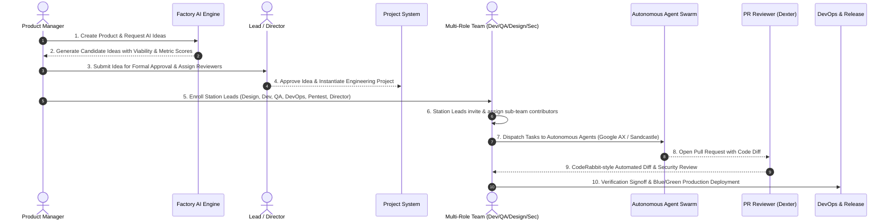

# 03. Software Factory Lifecycle & Multi-Window Workflow

## 🔄 End-to-End Product Engineering Lifecycle

Software Karkhana orchestrates a disciplined, multi-stage delivery pipeline from initial discovery down to post-launch telemetry:

---

## 🏢 Step-by-Step Station Breakdown

### Station 1: Product Management & AI Idea Engine
1. **Product Initialization**: PM creates an enterprise product anchor.
2. **AI Idea Generation**: Generates actionable feature hypotheses based on workspace domain and user persona.
3. **Metric Verification**: AI scores each idea across Business Viability, Technical Feasibility, and Risk.
4. **Approval Workflow**: PM assigns designated approvers (Directors / Engineering Managers) directly in the idea drawer.
5. **Project Instantiation**: Approved ideas are one-click converted into concrete engineering projects with linked milestones.

### Station 2: Project Setup & Multi-Window Lead Enrollment
1. **Lead Enrollment**: PM invites key station leads to the newly created project:
   - **Design Lead**: Responsible for canvas, wireframes, and design token contracts.
   - **Dev Lead**: Responsible for architecture, package boundaries, and repo setup.
   - **QA Lead**: Responsible for test matrices, unit/integration suites, and E2E coverage.
   - **DevOps Lead**: Responsible for CI/CD pipelines, container images, and Cloud Run jobs.
   - **Security Lead / Pentester**: Responsible for SAST/DAST, SBOM, and threat models.
   - **Dev Manager / Director**: Holds executive oversight and phase-gate approval rights.
2. **Sub-Team Delegation**: Each station lead has dedicated interface controls to invite specialists into their station without cluttering unrelated stations.

### Station 3: Multi-Agent Execution & Confined Workers
1. Agents receive scoped task prompts with contextual file ASTs and invariant rules.
2. Execution occurs inside isolated container runtimes (Google AX / Sandcastle environment).
3. Patch results are automatically verified against real test suites before opening PRs.

### Station 4: Issue & QA Defect Triage
1. PMs, Devs, and QA log bugs directly into the station issue board.
2. Direct assignment to specific engineers with bidirectional status sync.
3. Automated test scenario generation from bug descriptions.
