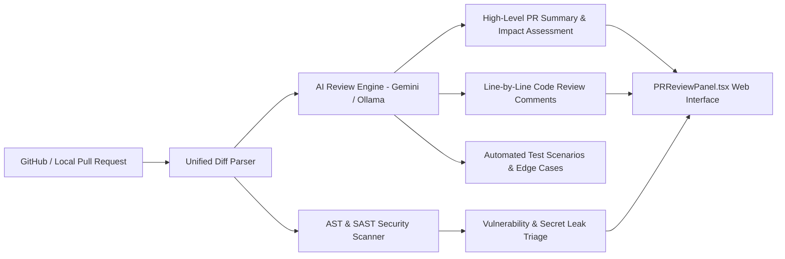

# 02. PR Reviewer & Code Intelligence (CodeRabbit / IBM Dexter Parity)

## 🎯 Overview & External Parity Benchmark

The Software Karkhana PR Reviewer station brings intelligent, automated pull request analysis directly into the factory workflow, drawing direct architectural inspiration and feature parity from:
- **IBM Dexter Repository**: [github.com/dhruvinsights/IBM_Dexter](https://github.com/dhruvinsights/IBM_Dexter)
- **Live Deployment**: [ibm-dexter.vercel.app/app/dashboard](https://ibm-dexter.vercel.app/app/dashboard)
- **CodeRabbit AI Review Engine**: Automated inline diff comments, security vulnerability triage, complexity analysis, and test verification.

---

## 🔬 Core Capabilities

### 1. High-Level Summary & Change Classification
- Generates an executive summary describing what was changed, why it was changed, and potential architectural ripple effects.
- Classifies changes by impact: **Breaking**, **Feature**, **Bugfix**, **Refactor**, **Security Patch**.

### 2. Line-by-Line Code Quality & Security Review
- Analyzes git diff hunks and attaches inline review notes with actionable suggestions.
- Flags anti-patterns (e.g. unhandled async promises, SQL injection vectors, missing null checks, hardcoded credentials).

### 3. Automated Test Scenario Generation
- Evaluates modified functions and proposes concrete test cases for unit and integration suites.
- Generates executable `pytest` snippets directly from the review drawer.

### 4. Interactive Review Actions & GitHub Sync
- **Approve / Request Changes / Comment**: Reviewers can post remarks directly to GitHub PRs via the GitHub API integration (`app/integrations/github.py`).
- **Ledger Verification**: Every review decision is signed and appended to the immutable SHA-256 evidence ledger.
